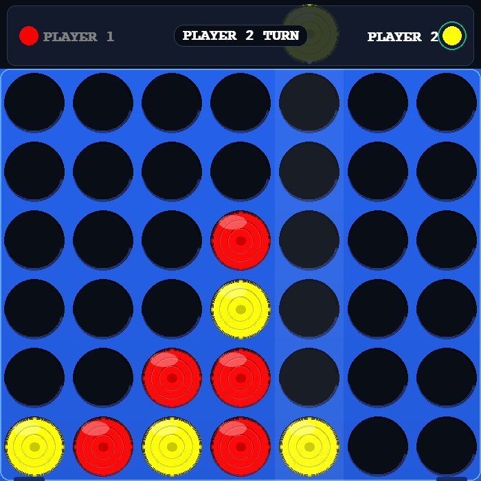
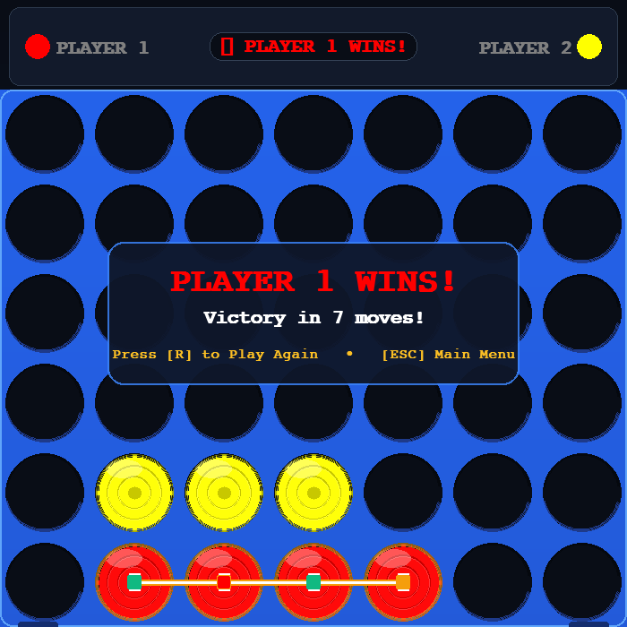
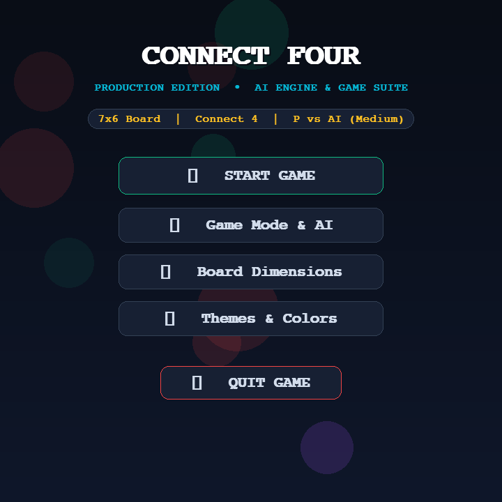
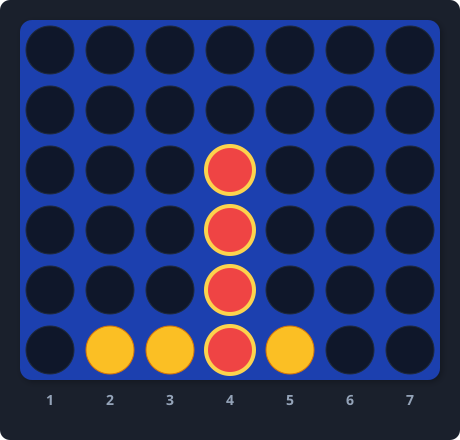

<div align="center">

<p>
  
</p>

# Connect Four

**Production-Grade Connect 4 Engine, Multi-Algorithm AI Suite & Headless Visualizer**

[](https://www.python.org/)
[-brightgreen?style=for-the-badge&logo=pytest)](tests/)
[](Makefile)
[](LICENSE)

</div>

---

## 📖 Overview

**Connect 4** is a modernized, production-ready implementation of the classic vertical connection game, engineered for high performance, modularity, and algorithmic depth.

Originally conceived as a Pygame application by [Mayank Singh](https://github.com/bymayanksingh), this repository integrates community PRs, academic research from Columbia University on Markov Decision Processes (MDPs), and production software engineering practices:

- **Decoupled Architecture**: Domain rules, board state, AI engines, terminal CLI, and Pygame presentation are separated into dedicated modules under `connect4/`.
- **Multi-Modal AI Suite**:
  - **Random Agent**: Uniform random sampling over legal open columns.
  - **Heuristic Agent**: Fast tactical 1-ply immediate win execution, threat blocking, and center preference.
  - **Minimax Agent**: Deep tree search with **$\alpha\text{-}\beta$ pruning**, center-first move ordering, and an **Odd-Even strategy heuristic**.
  - **Dynamic Programming (MDP) Agent**: Finite-horizon value iteration and exact **linear system solving** ($(I - \gamma P)^{-1} R$) over transition probability matrices.
- **Multi-Modal User Interfaces**:
  - **Pygame Desktop GUI**: Smooth animations, theme customizer (Red/Yellow, Green/Violet, Neon/Dark Blue, Monochrome), sound effects, and runtime diagnostics panel.
  - **Interactive ANSI Terminal**: Unicode disc display (`🔴`, `🟡`, `⚪`), full keyboard command parsing (`undo`, `restart`, `quit`), and 1-based indexing.
  - **Headless Benchmarking**: Automated headless tournament runner simulating AI vs AI matches with statistical reporting.
- **Configurable Dimensions & Win Conditions**: Arbitrary grid sizes (e.g. Standard 7×6 Connect 4, Mini 4×3 Connect 3, Large 8×7 Connect 4, or Custom N×M).
- **Automated Visualization Pipeline**: Export any board state directly to standalone **SVG vector graphics** or **Graphviz DOT graphs**.
- **100% Automated Test Coverage**: 37 unit and integration tests covering board mechanics, win detection, AI decision quality, CLI commands, and headless rendering.

---

## 🎨 Visual Showcase

<div align="center">
  <table>
    <tr>
      <td align="center"><b>Gameplay & Active HUD</b></td>
      <td align="center"><b>Victory Celebration & Laser</b></td>
      <td align="center"><b>Main Menu & Customization</b></td>
    </tr>
    <tr>
      <td></td>
      <td></td>
      <td></td>
    </tr>
  </table>
</div>

---

## 🤝 Community Pull Request Integration Audit

Every community pull request submitted to the repository has been audited, preserved, and elevated into the modern modular architecture:

| PR # | Author / Branch | Original Contribution | Modernized Production Implementation |
| :--- | :--- | :--- | :--- |
| **#44** | `official-Auralin` | Columbia Univ. MDP Dynamic Programming & parameter sweep | Modern MDP Agent ([`dp_agent.py`](file:///Users/mayank.singhhginsights.com/Documents/work/personal/connect4/connect4/ai/dp_agent.py)), closed-form linear solver $(I - \gamma P)^{-1} R$, and [`scripts/param_sweep.py`](file:///Users/mayank.singhhginsights.com/Documents/work/personal/connect4/scripts/param_sweep.py) |
| **#42** | `Pabloo22` | Minimax agent with $\alpha\text{-}\beta$ pruning & Odd-Even heuristic | Production Minimax engine ([`minimax.py`](file:///Users/mayank.singhhginsights.com/Documents/work/personal/connect4/connect4/ai/minimax.py)) with parity evaluation and center-first move ordering |
| **#39** | `adnansalik` | 1-ply tactical heuristic AI | High-speed Heuristic Agent ([`heuristic_agent.py`](file:///Users/mayank.singhhginsights.com/Documents/work/personal/connect4/connect4/ai/heuristic_agent.py)) for immediate win taking and threat blocking |
| **#38 / #35** | `Xx-Ashutosh-xX` / `ajaykumarr123` | Color themes (Violet, Yellow, darkBlue, gray, green, neonBlue) | Modern theme system in [`config.py`](file:///Users/mayank.singhhginsights.com/Documents/work/personal/connect4/connect4/config.py) & live in-game cycling via key `T` or GUI theme picker |
| **#36 / #33** | `KomalKalyan` | Interactive Start & Quit menu buttons and layout improvements | Redesigned capsule buttons, animated drifting background discs in [`menu.py`](file:///Users/mayank.singhhginsights.com/Documents/work/personal/connect4/connect4/gui/menu.py) |
| **#32 / #18** | `amanpalariya` | Support for arbitrary board dimensions and Connect-N | Generalized [`GameBoard`](file:///Users/mayank.singhhginsights.com/Documents/work/personal/connect4/connect4/board.py) and [`BoardDimensions`](file:///Users/mayank.singhhginsights.com/Documents/work/personal/connect4/connect4/types.py) supporting 4×3 mini, 7×6 standard, 8×7 large |
| **#28** | `amanpalariya` | Coin drop animation & board patterns | Realistic gravity physics drop animation with micro-bounce & audio sync in [`renderer.py`](file:///Users/mayank.singhhginsights.com/Documents/work/personal/connect4/connect4/gui/renderer.py) |
| **#24 / #22** | `Satvinder31415` | Test directory and basic win assertions | Comprehensive 37-test suite in [`tests/`](file:///Users/mayank.singhhginsights.com/Documents/work/personal/connect4/tests/) covering win conditions, ties, AI agents, CLI, and GUI |
| **#14** | `Satvinder31415` | Move undo bug fixes | Stack-based undo/redo with board state integrity in [`game.py`](file:///Users/mayank.singhhginsights.com/Documents/work/personal/connect4/connect4/game.py) |
| **#34** | `Cypre55` | Hall of Fame section | Contributor attribution and Hall of Fame recognized in documentation |

---

## 🏛️ Architecture & Project Hierarchy

```
connect4/
├── pyproject.toml              # PEP 517/621 packaging & pytest configurations
├── setup.py                    # Setuptools package definition
├── requirements.txt            # Core production dependencies (pygame, numpy, event-bus)
├── requirements-dev.txt        # Development dependencies (pytest, pytest-cov, ruff)
├── Makefile                    # Developer workflow automation
├── connect4/                   # Main Python application package
│   ├── types.py                # Domain models, Enums (Player, GameMode, AIDifficulty)
│   ├── config.py               # Theme palettes, geometry constants, asset locations
│   ├── board.py                # Pure GameBoard logic, gravity, win checks & serialization
│   ├── game.py                 # Core game session controller, turns & undo/redo stack
│   ├── events.py               # Decoupled EventBus and message dataclasses
│   ├── cli.py                  # Terminal interactive mode, benchmark runner, JSON mode
│   ├── ai/                     # Artificial Intelligence engine package
│   │   ├── base.py             # Abstract Base Class for AI agents
│   │   ├── random_agent.py     # Random selection
│   │   ├── heuristic_agent.py  # Fast tactical win/block heuristic
│   │   ├── minimax.py          # Minimax with alpha-beta & Odd-Even heuristic
│   │   ├── dp_agent.py         # Dynamic Programming & linear algebra MDP solver
│   │   ├── game_state.py       # State space hashable representation for MDP
│   │   └── factory.py          # Unified AgentFactory
│   ├── gui/                    # Desktop presentation package
│   │   ├── app.py              # Main Pygame application loop & screen manager
│   │   ├── renderer.py         # Board rendering, animations & console panel
│   │   ├── menu.py             # Interactive buttons, state selectors & themes
│   │   └── assets.py           # Safe asset loader with procedural fallbacks
│   └── visualizer/             # Diagram and vector export pipeline
│       └── export.py           # ASCII, SVG vector, and Graphviz DOT exporters
├── assets/                     # Media files (images, theme sprites, sounds)
│   ├── images/
│   └── sounds/
├── tests/                      # Automated test suite (37 tests)
│   ├── conftest.py             # Headless fixtures
│   ├── test_board.py           # Board mechanics & serialization
│   ├── test_win_conditions.py  # Connect-N, diagonals, verticals, ties
│   ├── test_game_flow.py       # Turn switching, undo/redo, restart
│   ├── test_ai_agents.py       # Decision verification for all AI algorithms
│   ├── test_agent_factory.py   # Factory validation
│   ├── test_cli.py             # CLI parser and tournament tests
│   ├── test_visualizer.py      # SVG/DOT/ASCII export verification
│   └── test_gui_headless.py    # Headless GUI rendering tests
├── scripts/                    # Developer tools & research scripts
│   ├── param_sweep.py          # MDP parameter sweep (gamma vs horizon)
│   ├── benchmark_ai.py         # AI tournament execution CLI
│   └── export_diagram.py       # Board diagram exporter
└── legacy/                     # Historical prototype archive
    └── v1_original/
```

---

## ⚡ Quickstart & Installation

### Option 1: Using `uv` (Recommended)

```bash
# Clone the repository
git clone https://github.com/bymayanksingh/connect4.git
cd connect4

# Create virtual environment and install dependencies
uv venv
source .venv/bin/activate
uv pip install -r requirements.txt -r requirements-dev.txt
```

### Option 2: Using standard `pip` & `make`

```bash
python3 -m venv .venv
source .venv/bin/activate
make dev-install
```

---

## 🎮 How to Play

### 1. Graphical User Interface (Pygame)

Launch the graphical game with full menu support, board size selection, and theme customization:

```bash
python game.py
# or
python -m connect4 --gui
```

**GUI Controls:**
- **Mouse Movement**: Move the disc preview over the desired column.
- **Left Click**: Drop piece into the column.
- **Ctrl + Z**: Undo last move (in Player vs AI mode, undos both moves).
- **R**: Restart game session.
- **Esc**: Return to Main Menu.

---

### 2. Interactive Terminal CLI

Play directly in your terminal with rich ANSI coloring and Unicode disc indicators:

```bash
# Human vs Human (PvP)
python -m connect4 --mode pvp

# Human vs AI (PvA) with Minimax AI
python -m connect4 --mode pva --ai hard

# Custom board dimensions (e.g. 8x7 Connect 4)
python -m connect4 --rows 7 --cols 8 --connect 4
```

```text
╔═══╦═══╦═══╦═══╦═══╦═══╦═══╗
║ ⚪ ║ ⚪ ║ ⚪ ║ ⚪ ║ ⚪ ║ ⚪ ║ ⚪ ║
╠═══╬═══╬═══╬═══╬═══╬═══╬═══╣
║ ⚪ ║ ⚪ ║ ⚪ ║ ⚪ ║ ⚪ ║ ⚪ ║ ⚪ ║
╠═══╬═══╬═══╬═══╬═══╬═══╬═══╣
║ ⚪ ║ ⚪ ║ ⚪ ║ 🔴 ║ ⚪ ║ ⚪ ║ ⚪ ║
╠═══╬═══╬═══╬═══╬═══╬═══╬═══╣
║ ⚪ ║ ⚪ ║ 🟡 ║ 🔴 ║ ⚪ ║ ⚪ ║ ⚪ ║
╠═══╬═══╬═══╬═══╬═══╬═══╬═══╣
║ ⚪ ║ 🟡 ║ 🔴 ║ 🔴 ║ 🟡 ║ ⚪ ║ ⚪ ║
╚═══╩═══╩═══╩═══╩═══╩═══╩═══╝
   1   2   3   4   5   6   7

Player 1 (Red) > 4
```

---

### 3. Headless AI Tournament Benchmarking

Run high-speed automated tournaments between any two AI engines:

```bash
python -m connect4 --benchmark --ai1 hard --ai2 easy -n 10
```

```text
============================================================
         CONNECT 4 HEADLESS BENCHMARK TOURNAMENT
============================================================
Agent 1 (Player 1 - Red):    P1 (hard)
Agent 2 (Player 2 - Yellow): P2 (easy)
Board size:                  7x6 (Connect 4)
Matches scheduled:           10
------------------------------------------------------------
Game  1/10: P1 WIN  in  9 moves (0.385s)
Game  2/10: P1 WIN  in  9 moves (0.381s)
...
------------------------------------------------------------
                     FINAL RESULTS
------------------------------------------------------------
Agent 1 (hard) Wins: 10 (100.0%)
Agent 2 (easy) Wins: 0 (0.0%)
Draws:                   0 (0.0%)
Avg Moves per Match:     9.0
Total Wall-Clock Time:   3.821s (0.382s/game)
============================================================
```

---

### 4. Vector SVG & Graphviz Diagram Export

Export any board state into vector SVG or Graphviz DOT format:

```bash
# Export board state on game over
python -m connect4 --export-svg docs/board.svg --export-dot docs/board.dot

# Or run the export script
python scripts/export_diagram.py --svg docs/board.svg --dot docs/board.dot
```

<div align="center">
  
</div>

---

## 🧠 AI Algorithms & Theoretical Foundations

### 1. Markov Decision Process (MDP) & Linear Algebra Solver

Connect 4 is formalized as a zero-sum, deterministic MDP $(S, A, T, R, \gamma)$:
- **State space ($S$)**: Board configurations $(r \times c)$ and turn indicator $t \in \{0, 1\}$.
- **Action space ($A(s)$)**: Legal open columns.
- **Transition ($T(s, a)$)**: Deterministic gravity drop $s' = T(s, a)$.
- **Reward ($R$)**: $+200$ for win, $-200$ for loss, $0$ for draw, $-0.01$ step cost.

Under stationary policy $\pi$, the Bellman expectation equation:

$$V^{\pi} = R^{\pi} + \gamma P^{\pi} V^{\pi}$$

is rearranged into a solvable linear system:

$$(I - \gamma P^{\pi}) V^{\pi} = R^{\pi} \implies V^{\pi} = (I - \gamma P^{\pi})^{-1} R^{\pi}$$

`DPAgent` enumerates reachable states within horizon $H$, builds the transition matrix $P$, and computes exact values using `numpy.linalg.solve`.

Run parameter sweeps over discount factor $\gamma$ and horizon $H$:
```bash
python scripts/param_sweep.py
```

### 2. Minimax with $\alpha\text{-}\beta$ Pruning & Odd-Even Strategy

`MinimaxAgent` explores the game tree up to depth 5 with:
- **Alpha-Beta Pruning**: Prunes branches that cannot influence the final decision.
- **Center-First Move Ordering**: Prioritizes central columns to trigger earlier $\alpha\text{-}\beta$ cutoffs.
- **Odd-Even Heuristic**: Incorporates parity theory—favoring odd-row control for Player 1 and even-row control for Player 2.

---

## 🧪 Testing & Quality Assurance

The codebase includes 37 automated tests verifying:
- Core board mechanics, gravity, full-column rejection, bounds safety.
- Complete win conditions (horizontal, vertical, both diagonals, Connect-N generalizations, tie games).
- AI decision-making (immediate wins, defensive blocks, center preference, linear algebra solver).
- CLI commands, headless tournament execution, and JSON output.
- Headless Pygame surface generation and rendering.

Run all tests via:
```bash
make test
# or
pytest -v
```

```text
============================= test session starts ==============================
tests/test_agent_factory.py ....                                         [ 10%]
tests/test_ai_agents.py ......                                           [ 27%]
tests/test_board.py ........                                             [ 48%]
tests/test_cli.py .                                                      [ 51%]
tests/test_dp_agent_tiny.py .                                            [ 54%]
tests/test_game_flow.py .....                                            [ 67%]
tests/test_gui_headless.py ..                                            [ 72%]
tests/test_visualizer.py ....                                            [ 83%]
tests/test_win_conditions.py ......                                      [100%]
============================== 37 passed in 14.33s =============================
```

---

## 📄 License
This project is licensed under the [MIT License](LICENSE).
Original implementation by [Mayank Singh](https://github.com/bymayanksingh).
MDP research contributions by Bobby Veihman (Columbia University).
